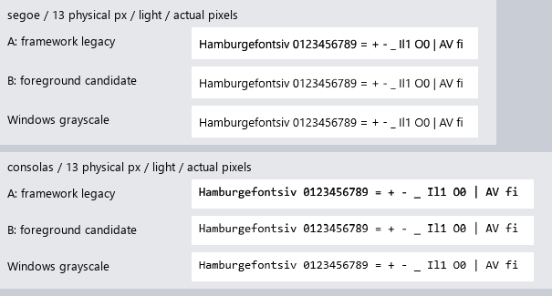

# Foreground-aware text coverage — approved baseline B

Implemented and approved 20 October 2026. **B is now the shared Aurora default.**
The owner's [decision](decision.json) also authorizes continued native-fidelity
work. The original captures and measurements below are preserved. New validation
and the next hinting experiment are in [native-text-progress](../native-text-progress/README.md).

**DPI evidence correction:** the original software application captures labeled
144 DPI were actually 96 DPI because the headless platform discarded the
injected scale. Original reviewed bytes/hashes remain intact. The corrected
baseline/candidate matrix is in native-text-progress, with actual framebuffer
assertions and a window DPI regression. See [capture-errata.json](capture-errata.json).

[Open the visual review](index.html), starting with
[current Pad++ at 100%](padpp-current-host-96/review.html) or
[150%](padpp-current-host-144/review.html). A is the former host's 0.75 contrast;
B is foreground-aware coverage with maximum contrast 0.5. Other application
reviews normalize A and B to 0.5 to isolate the engine change.

## Change

`AURORA_TEXT_COVERAGE=foreground` is now the default framework policy in
`aurora.text.atlas`. Canvas supplies the text's foreground color when looking
up a glyph. The atlas retains unmodified outline coverage and derives masks
for up to sixteen encoded-luminance classes. Dark text receives less contrast
boost; near-white text keeps the existing transfer. Opacity is applied after
correction. A color change does not rerasterize the outline.

Both immediate and retained Canvas use this lookup. Software and Vulkan receive
the same A8 masks; their shaders, image blending, shaping, layout, and glyph
metrics are unchanged. Bitmap and color glyph paths retain their prior behavior.
The legacy mode remains available as an explicit compatibility override.
Invalid non-finite contrast values now safely fall back to 0.5.

This is a foreground-aware approximation, not full background-sensitive gamma
correction or a replacement for hinting. The experimental hinter remains off.
The host now inherits this policy; its former 0.75 override was removed.

## Evidence

Fresh Segoe UI and Consolas corpus at 11, 12, 13, 17, 18, 20 and 26 physical px,
on light/dark backgrounds, compares identical glyph IDs and origins against
DirectWrite grayscale. Mean absolute grayscale error on union of ink pixels:

| Font / physical size | Legacy light | Candidate light | Legacy dark | Candidate dark |
|---|---:|---:|---:|---:|
| Segoe UI 13 px | 36.89 | 27.66 | 23.80 | 23.80 |
| Segoe UI 17 px | 40.01 | 25.24 | 23.10 | 23.10 |
| Consolas 13 px | 51.57 | 40.62 | 34.69 | 34.69 |
| Consolas 17 px | 39.94 | 26.09 | 24.88 | 24.88 |

Candidate light error is lower in all **14** font/size cases. Near-white dark
captures are pixel-identical in all **14** cases. Legacy mode also matches all
**20** saved earlier corpus images checked, byte for byte. This measures native
similarity, not subjective readability, and no capture has exact native parity.



Real older Notepad screens and generic host editor screens are captured in both
themes at 96/144 DPI. Notepad's actual View → Dark Theme action supplies its dark
skin. Pad++ uses its current light skin at both scales; the harness populates its
editor and tab strip without running the Python client. No new Pad++ dark skin
is invented for this review. Selected text, Ukrainian/Greek/Latin samples, and
colored/translucent text are included across the fixtures.

Actual on-screen Vulkan captures validate two changing marker states in each
mode. Comparison with the software renderer finds 12 differing pixels across
both frames, maximum channel error **1**, in each mode. The captures are from
the GPU window's screen pixels, not `GuiWindow.saveScreenshot`'s software mirror.
The live test ran at the display's 96 DPI. Application captures at 144 DPI are
software; GPU parity at 144 DPI is not claimed.

In the Pad++ fixture, both modes fit in a 512×512 atlas at both scales, with
368 outline rasterizations each. The candidate can use more atlas space with
many colors: one raw mask plus up to fifteen additional masks per
glyph/size/phase; the 4096×4096 limit remains. No throughput or worst-case memory
improvement is claimed. Hot color/opacity cache reuse and growth are covered by
the new test.

## Original validation and subsequent decision

See [validation.json](validation.json) for every result.

Passed: new coverage/growth/cache/opacity/mixed-surface tests; 1,872 existing
glyph checks in **both** modes; DPI tests in both modes; six comparison-tool
tests; live Vulkan capture; retained Vulkan interaction with zero measured
content rebuilds or geometry uploads; full host verification in legacy mode.

**Original candidate full host verification failed its ink-density gate:**
`0.0477 < 0.061`. The lighter candidate is closer to the native reference but
did not satisfy the old weight. Earlier scene/control/editor and UI action checks
completed. After the owner chose B, the minimum was explicitly updated to 0.045
around the reviewed 0.0477 fixture, with the decision recorded above. Full host
verification now passes with the shared default. The original failure remains
in validation.json and has not been rewritten as a historical success.

The older Notepad full smoke had the same drag/restore assertion failure at
`tests/headless_smoke.d:120` in both modes. The standards audit now distinguishes
the native Fan Control and standalone Music packages from toolkit applications,
includes dependency-based experiments, and passes.

## Reproduction

Run the focused suite from `vendor/aurora-d-0.4.5`:

```text
dub run --config=text-coverage-test
```

Regenerate all corpus/application/GPU captures from the repository root:

```text
python -B artifacts/text-coverage-candidate/run.py
```

This builds isolated binaries under `build-validation`; it does not overwrite
installed application executables. Live capture briefly opens its own probe
window. Repackage existing captures without launching applications:

```text
python -B artifacts/text-coverage-candidate/package.py
```

Rebuilt apps select B automatically. To explicitly select it in PowerShell:

```powershell
$env:AURORA_TEXT_COVERAGE = 'foreground'
$env:AURORA_TEXT_CONTRAST = '0.5'
```

`AURORA_TEXT_COVERAGE=legacy` selects the previous framework transfer. Experimental
hinting remains disabled by default. Approval of B does not promote later hinting
experiments or establish exact native parity.
