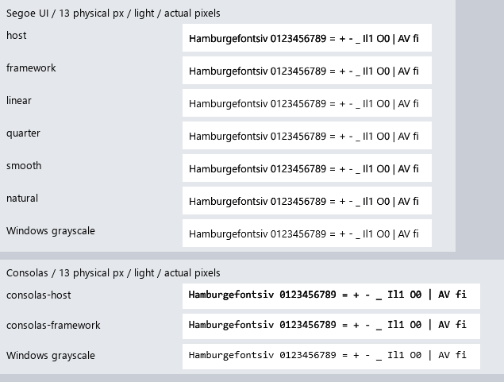

# Aurora text-rendering audit — 20 October 2026

Aurora needs an improvement to its shared small-text rendering, especially its
color/contrast correction on light surfaces. There is no more mature private
Aurora-D renderer in another application to promote. The host's stronger
contrast override makes the tested native-reference error worse.

This is an audit, not an approved replacement default. No application or
framework source, defaults, or reference images were changed.

## What is already shared

Notepad, Font Viewer, Cut, OpenCode/OpenCode Pro, the web painter, and the host
use `vendor/aurora-d-0.4.5/source`. Their text reaches the same `FontSystem`,
shaping/layout engine, outline rasterizer, glyph atlas, and Canvas path. The
host uses a DUB path dependency; the older applications include that source
tree directly. Rebuilding these applications picks up a shared engine fix.

Existing facilities include OpenType shaping/fallback, fractional advances,
horizontal glyph-phase caching, physical-size DPI rasterization, and grayscale
antialiasing. The shipping policy is `sharp`, coverage contrast `0.5`, with
experimental TrueType bytecode hinting disabled. Font Viewer is a specimen UI
for this same engine. Larger text in another application is not evidence of a
different renderer.

There are native Windows exceptions: Fan Control uses Win32 controls, and
OpenCode Pro's rebuild splash uses GDI text. These are OS surfaces, not an
alternative text renderer integrated into Aurora's retained software/Vulkan
widgets. The existing `GdiFont` wrapper cannot simply replace Canvas text while
preserving layout, selection, clipping, DPI, and GPU behavior.

## Findings in the host and Pad++

- `experiments/aurora-host/source/experiment/aurorahost/main.d` sets
  `AURORA_TEXT_CONTRAST=0.75` when absent; the framework uses `0.5`. This is an
  application override, not a new antialiasing engine.
- The transfer increases all partial glyph coverage before atlas caching,
  regardless of foreground/background color. Increasing it adds apparent weight
  but does not improve outline placement or resolve fine stem detail.
- Pad++ chooses the caption tier (`fontScale: 1`, 13 logical px), also for its
  editor unless zoomed, and explicitly uses 11–12 px secondary text. Those are
  particularly sensitive sizes at 100% DPI. Its actual colors and compact
  layout also affect perceived quality.
- The standard audit scans `aurora-*/source`, not `experiments/*/source`, so it
  currently misses this host override. Its two existing manifest failures are
  Fan Control (native Win32) and Music (standalone synthesizer), not evidence
  that those applications carry a superior Aurora-D font engine.

## Fresh measurements

The existing DirectWrite comparison tool rendered identical font files, glyph
IDs, and positioned origins at **11, 12, 13, 17, 20, and 26 physical px** on white
and dark backgrounds. Native settings: gamma 1.8, grayscale contrast 1.0,
ClearType contrast 0.5. The test isolates rasterization/compositing, not shaping.

At 13 px, mean absolute grayscale error on the union of ink pixels was:

| Font / setting | Light | Dark |
|---|---:|---:|
| Segoe UI, current host (`sharp`, 0.75) | 53.01 | 30.78 |
| Segoe UI, framework default (`sharp`, 0.5) | 36.89 | 23.80 |
| Segoe UI, linear diagnostic (`sharp`, 0) | 27.66 | 33.04 |
| Segoe UI, reduced contrast (`sharp`, 0.25) | 29.66 | 28.07 |
| Segoe UI, `smooth`, 0.5 | 39.62 | 26.91 |
| Segoe UI, experimental `natural`, 0.5 | 27.47 | 6.91 |
| Consolas, current host (`sharp`, 0.75) | 67.43 | 42.44 |
| Consolas, framework default (`sharp`, 0.5) | 51.57 | 34.69 |

Lower error means closer to this native grayscale reference, **not a subjective
readability score**. Host 0.75 was worse than 0.5 in all 24 font/size/theme cases.
Reducing contrast helps the tested light Segoe samples but hurts dark samples;
neither one fixed contrast adjustment nor `smooth` resolves the problem.
None of the eight completed six-size configurations matched native grayscale
exactly in any of its twelve captures. Exact equality is a diagnostic here,
not a proposed definition of acceptable text quality.



[All light comparisons](comparison-light.png) ·
[All dark comparisons](comparison-dark.png) ·
[Full measurements and hashes](summary.json)

The experimental `AURORA_HINTING=natural` mode improves some Segoe samples but
**crashes on Consolas at 26 px** in this corpus. The failing access is in
`aurora/text/hinter.d:1280` (MSIRP handling), with an out-of-range reference-point
index. This audit does not establish the upstream cause of that invalid state.
Keep the mode disabled; see the [captured failure](consolas-natural-failure.txt).

An isolated `H` confirms the existing compositor limitation: at 13 px, 17 native
light/dark pixel pairs cannot be reproduced by *any* shared A8 value under
Aurora's current blend formula; at 26 px there are 34. The neutral native
reference (gamma 1, contrast 0) has zero incompatible pairs at both sizes.
Changing only the atlas transfer cannot obtain exact parity on both themes.
This agrees with the earlier `FONT_QUALITY_VALIDATION.md` findings.

Microsoft documents separate glyph rendering, grayscale antialiasing and alpha
correction in its [DirectWrite/Direct2D overview](https://learn.microsoft.com/en-us/windows/win32/direct2d/direct2d-and-directwrite).
Using an OS renderer is an architectural alternative, not an existing hidden
Aurora setting.

## Recommended direction

1. Use the shared `sharp`/0.5/hinting-off policy as the compatibility baseline.
   The host's 0.75 override should not become the Aurora default. Compare its
   removal separately against the current host before changing screenshots.
2. Improve color/alpha correction in the shared text drawing/compositing path.
   Preserve reusable outline coverage in the atlas; evaluate correction using
   foreground luminance, opacity, and target-surface assumptions. A whole-window
   light/dark flag is insufficient for mixed surfaces, selections, and popups.
   Software and Vulkan must implement the same policy. This is the recommended
   first rendering experiment within Aurora's current pure-D design.
3. Improve small-size stem placement and hinting separately. Repair the
   experimental hinter's safety/conformance failures before evaluating it as a
   candidate. A lower error for one font cannot justify enabling it globally.
4. Keep typography roles explicit: UI sans versus editor monospace, readable
   sizes and spacing, with compact sizes available intentionally. Enlarging all
   widgets would mask part of the issue without fixing the renderer.
5. Before promotion, compare old and new apps in light/dark at 100% and 150%
   DPI, mixed colors/selections, additional fonts/scripts, and both renderers.
   Apply the chosen default in Aurora-D, remove duplicate application policy,
   extend the standards audit to dependency-based experiments, then rebuild apps.

The repository's `AURORA-QUALITY-RATCHET.md` requires reviewed A/B evidence and an
owner decision before changing the shared default. No candidate is promoted by
this audit. An optional Windows DirectWrite backend is a separate possible
project if native Windows rasterization becomes a requirement; it would need
proper cache/compositor integration and an explicit cross-platform fallback.

## Application captures and validation

The audit builds a separate host executable and renders the current Pad++ scene
at 1180×760, 96 DPI, headless software. These are scene captures; the Python
client is not running, so app-populated tab/status content is absent.

- [Current host, 0.75](padpp-current-host.png)
- [Framework baseline, 0.5](padpp-framework-default.png)
- [Linear diagnostic, 0](padpp-linear-diagnostic.png)
- [Interactive host A/B review](host-review/review.html): A is current host
  0.75; B is framework 0.5. Neither selection promotes a new framework policy.

Fresh framework checks passed: fractional layout/phase cache and **1,872**
glyph/size/phase checks using the Inter fixture; DPI geometry and physical-size
glyph tests at 120/144/192 DPI. The six Python native-comparison tests passed.
The standards audit tests have two pre-existing failures for the non-Aurora-D
packages described above. No on-screen Vulkan parity or rendering performance
claim is made; the current evidence is sufficient to reject the host override
as an unqualified upgrade, not to approve a replacement renderer.

Reproduce the captures, measurements, and experimental failure:

```text
python -B artifacts/text-rendering-audit-2026-10-20/audit.py
```

Run the existing framework suites from `vendor/aurora-d-0.4.5`:

```text
dub run --config=font-quality-test
dub run --config=dpi-rendering-test
```

Run the Python suites from the repository root:

```text
python -m unittest scripts.tests.test_font_comparison
python scripts/audit-aurora-standards.py
```

The focused framework checks during this audit were compiled directly with DMD,
`-i -O -version=AuroraHeadless`, using the same test source files. The font
regression executable received `tests/fonts/InterVariable.ttf` explicitly.
