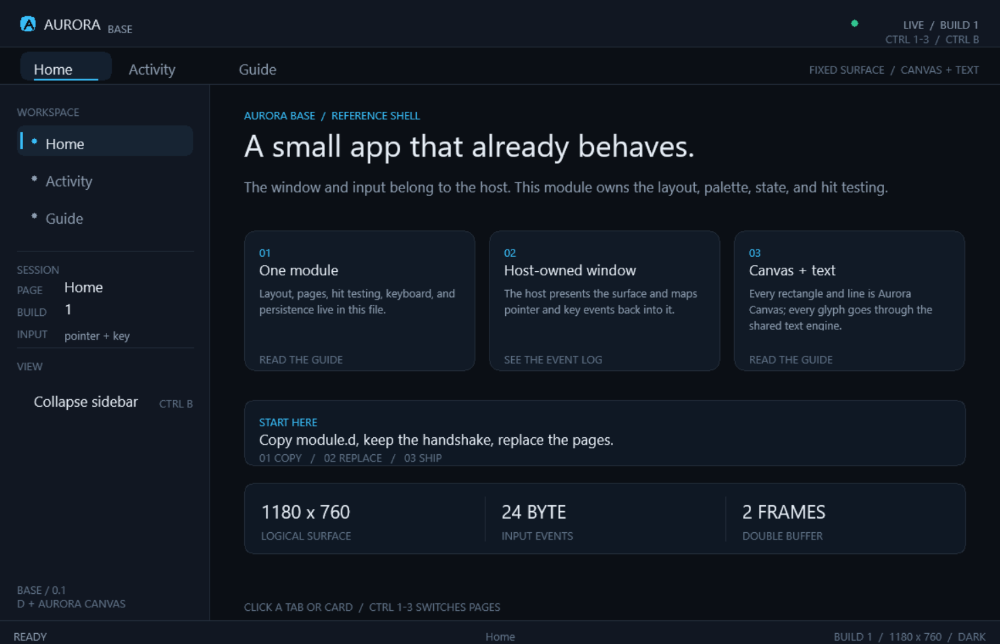
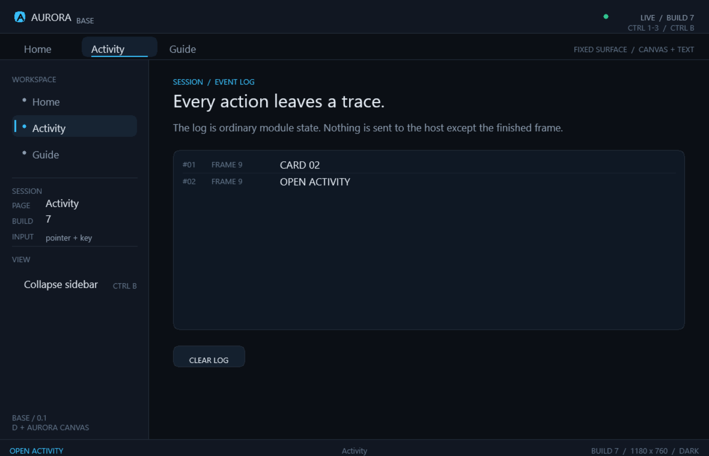
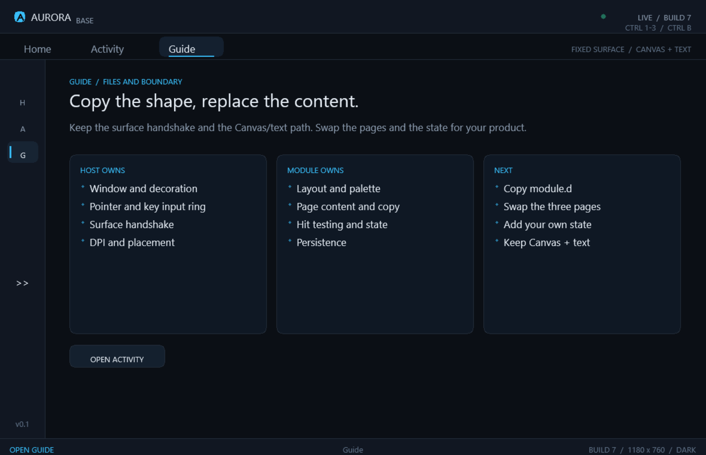

# Aurora Base

The reference live app: one dark D module that already has the shell, state,
input handling, and verification loop the rest of the suite expects.

Use it as the starting point for a new Aurora program. Create a renamed copy
with the generator, replace the three pages, and keep the surface handshake and
the Aurora Canvas/text path:

```text
python -B aurora/scripts/new_app.py my_app --title "My App"
```

Add `--blank` for a single empty workbench page instead of the three demo
pages.



## Run

```text
python -B aurora/apps/base/run.py
```

Or double-click [`RUN-BASE.bat`](RUN-BASE.bat). The launcher starts
`aurora-hotswap`, which builds `module.d`, opens the host window, and watches the
source. Edit `module.d` while the window is open; hotswap rebuilds in place.

### Startup trace

`run.py` prints the ordered startup chain as it happens, and the same lines stay
in `build/base/hotswap.log`:

```text
Starting Aurora Base...
workspace ...\aurora\apps\base\build\base
[trace] 0 ms  begin
[trace] 0 ms  workspace ready
[trace] 4 ms  module cache hit
[trace] 9 ms  host spawned
[trace] 117 ms  module spawned
READY
LISTEN 127.0.0.1:...
aurora-host: renderer=Vulkan hardware=true fallback=
[trace] 630 ms  host control connected
[trace] 631 ms  module state published
[trace] 634 ms  surface mapped
[trace] 664 ms  first frame captured
[1] build=1 buildMs=1 cache=hit startupMs=664 hostPid=...
RUNNING Aurora Base hotswapPid=...
READY in 692 ms
```

The first launch is a cache miss: it builds in about 829 ms and reaches the first
frame around 1.7 s. Later launches reuse `build/base/.cache` and reach the first
frame in about 0.66 s. The cache is invalidated by `module.d` or framework source
changes. Development hotswap builds use plain `dmd -i`; release and packaging
builds keep their own optimization settings.

The remaining fixed cost is host startup (about 0.63 s, mostly Vulkan and window
creation). Everything after the host control connection is under 40 ms.

From `aurora-host/`:

```text
aurora-hotswap.exe dev --source ../apps/base/module.d --host aurora-host.exe --out build/base --watch 3600 --events pointer,key --title "Aurora Base" --width 1180 --height 760
```

`build/base.exe` is the child module, not a standalone program. It normally
requires `--surface` and `--state` from the host workflow. Launching it directly
from Explorer hands off to the adjacent `run.py` launcher when it is present; if
no launcher is found, it prints the required arguments and exits instead of
throwing.

## What it demonstrates

- **One module, one surface.** The host owns the window, the shared surface
  handshake, DPI scaling, and the input ring. This module owns the shell.
- **A ready dark shell.** Brand bar, tab strip, collapsible sidebar, three pages,
  status bar, hover and pressed states.
- **Aurora Canvas + text.** Every background, card, line, icon dot, and glyph is
  painted through `aurora.Canvas` and the shared text engine. No GDI, no native
  text API, no private glyph cache.
- **Real interaction.** Pointer down/up hit testing, `Ctrl+1..3` page switching,
  and `Ctrl+B` sidebar collapse. Input arrives through the 24-byte ring.
- **Session state.** Active page and sidebar state persist through `--state`.
- **A live build stamp.** The top bar and status bar show the hotswap build
  number, so a reloaded module is visibly the new one.

## Pages

| Page | Purpose |
|---|---|
| Home | The shell's landing page: three cards that explain the boundary and link into the rest of the base. |
| Activity | A frame-stamped event log. Every tab, card, and sidebar action is recorded. |
| Guide | The host/module split and the "copy, replace, ship" checklist. |

Activity after a card click, with `Ctrl+B` available:



Guide with the sidebar collapsed by `Ctrl+B`:



## Files

| File | Role |
|---|---|
| [`module.d`](module.d) | The whole app: surface, model, layout, painting, input, persistence. |
| [`run.py`](run.py) | Detached launcher for the live workflow. |
| [`smoke_test.py`](smoke_test.py) | Builds and launches through hotswap, checks the first frame and its 1180x760 composition. |
| [`interaction_test.py`](interaction_test.py) | Drives the real host control channel: card click, Ctrl+B, Ctrl+3, and state. |
| [`README.md`](README.md) | This file. |

## Make it yours

1. Run `python -B aurora/scripts/new_app.py <your-app> --title "<Your App>"`
   from `aurora/`. It creates a renamed copy without build output or previews.
   Add `--blank` for a single empty workbench page.
2. Replace `drawHome`, `drawActivity`, and `drawGuide` with your pages.
3. Keep `LiveSurface`, `Base.onInput`, and the publish loop. They are the
   contract with the host.
4. Keep all text on `canvas.layoutText`/`drawLayout`; do not add a native text
   path or a private rasterizer.
5. Replace the sample state keys in `saveState`/`loadState`.
6. Run `python -B aurora/apps/<your-app>/smoke_test.py` and
   `interaction_test.py` before the first live session.

## Boundary

The host owns the window, placement, surface mapping, frame freshness, and
input routing. This module owns layout, palette, page content, hit testing, and
session state. The host never loads the module; hotswap supervises it.

The surface is a fixed 1180x760 logical composition. The host keeps the aspect
ratio with `fit: "contain"` and maps pointer coordinates back into surface
space. If a product needs native reflowing chrome, use the host-scene path in
[`apps/browser-mockup-host`](../browser-mockup-host/README.md); this base is
the live-module path.

## Next capability

The chosen next extension is dynamic document tabs with dirty state. The current
tabs are fixed reference views; the base does not yet model documents.

## Verify

```text
python -B aurora/apps/base/smoke_test.py
python -B aurora/apps/base/interaction_test.py
python -B aurora/scripts/new_app_test.py
```

Expected:

```text
PASS Aurora Base live host shot=... bytes=...
PASS Aurora Base input page=2 navCollapsed=True ...
PASS scaffold generator ...
```

The smoke check copies the source to a temporary folder, runs the real hotswap
workflow, and validates the first host frame. The interaction check uses the real
host control channel and a fresh module build. Neither reuses stale build
output.
