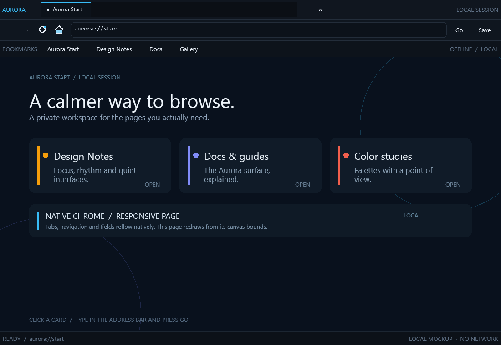

# Aurora Browser Mockup — Host Scene



A reflowing browser mockup built as an Aurora host scene. The host owns the
window, tab strip, toolbar rows, address field, labels, layout, and painting.
The controller owns page state and replaces the flexed page canvas when state or
available canvas bounds change. Resizing the window moves and resizes real
elements; it does not scale a fixed bitmap.

This is the host-scene companion to the live `browser-mockup` sample. The live
sample remains a fixed-surface/Canvas example; this one is the responsive GUI
path.

## Run

From this folder:

```text
python -B run.py
```

Or double-click [`RUN-HOST-MOCKUP.bat`](RUN-HOST-MOCKUP.bat). The host window
stays open; close it to end the controller.

## What Is Host-Owned

- `tabs` widget: labels, active state, tab widths, hover, and click routing.
- Back, forward, reload, home, Go, Save, and bookmark buttons.
- The address `textField` and its native text editing.
- The status labels and all row/column layout.
- The page `canvas` node: painting, clipping, and pointer routing.

The controller only sends page state (`setTabs`, `setText`, `setCanvas`) and
redraws the canvas from its current bounds. The canvas is also driven by
`getBounds` on tick events, so the page columns and card grids reflow after a
window resize.

## Try

- Switch tabs with the host tab strip; add and close tabs with `+`/`×`.
- Click Back/Forward/Home/bookmark buttons.
- Type in the address field and click **Go**.
  - `design`, `docs`, `gallery`, `home` navigate locally.
  - `docs input`, `docs frames`, and `docs lifecycle` select docs sections.
  - Unknown text opens the local Search page.
- Click cards, docs sections, gallery swatches, and search results.
- Resize the window: the native chrome reflows immediately; the page canvas
  redraws against its new bounds.

## Files

- [`scene.json`](scene.json) - the host-owned window, rows, tabs, fields,
  buttons, status labels, and flexed page canvas.
- [`controller.py`](controller.py) - page state, local search, native action
  handling, and responsive canvas command generation.
- [`run.py`](run.py), [`RUN-HOST-MOCKUP.bat`](RUN-HOST-MOCKUP.bat) - launcher.
- [`smoke_test.py`](smoke_test.py) - starts the real host, clicks native
  bookmarks, verifies a native new tab and address Go, resizes the scene, and
  checks the flexed page canvas bounds. The host is launched with `--minimized`
  for every test.
- [`visual_snapshot.py`](visual_snapshot.py) - renders previews through the
  headless host; it never opens a window.
- [`host_input_test.d`](host_input_test.d) and
  [`native_input_test.py`](native_input_test.py) - compile a headless
  `GuiWindow`, click a native bookmark through `UiTestDriver`, and verify the
  flex canvas grows after a logical resize. No window is opened.
- [`preview-design.png`](preview-design.png) - Design page in the host scene.
- [`preview-docs.png`](preview-docs.png) - Docs page in the host scene.
- [`preview-gallery.png`](preview-gallery.png) - Gallery page in the host scene.
- [`preview-search.png`](preview-search.png) - local Search page in the host scene.
- [`preview-large.png`](preview-large.png) - reflowed 1400×900 start page.

## Verify

```text
python -B aurora/apps/browser-mockup-host/smoke_test.py
python -B aurora/apps/browser-mockup-host/visual_snapshot.py
python -B aurora/apps/browser-mockup-host/native_input_test.py
```

Expected:

```text
PASS host-scene browser page=gallery canvas=(1100, 604)->(1400, 744)
PASS headless previews start=(1100, 760) design=(1100, 760) docs=(1100, 760) gallery=(1100, 760) search=(1100, 760) large=(1400, 900)
PASS native headless widget click action=bookmark.design page=1400x744
```

The test checks that canvas bounds change after a minimized resize. The headless
renderer produces the visual previews without opening a window.

## Boundary

The host scene owns generic GUI behavior. The controller owns product content
(pages, local query matching, swatch selection, and per-tab history). The page
canvas uses Aurora Canvas primitives and text; it does not use GDI or a private
text rasterizer.
