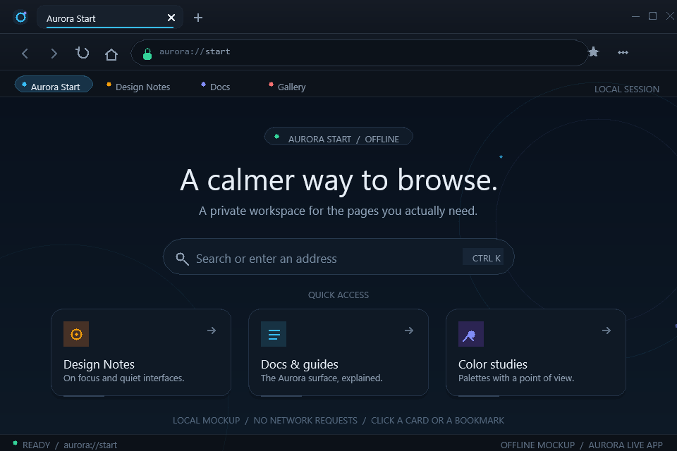

# Aurora Browser Mockup



An interactive browser-shell sample for Aurora Host v2. It is a single live D
module: no network stack, no embedded HTML engine, and no app-specific code in
the generic host. The shell, the four sample pages, and all navigation state
live in [`module.d`](module.d). All drawing and text use Aurora's portable
`Canvas` and `FontSystem`; there is no GDI or native text path.

The point is the interaction model. Tabs, history, address suggestions,
bookmarks, the overflow menu, the docs sidebar, and the gallery swatches are
ordinary rectangles that are both drawn and hit-tested by the module.

## Run

Double-click [`RUN-BROWSER-MOCKUP.bat`](RUN-BROWSER-MOCKUP.bat), or run:

```text
python -B aurora/apps/browser-mockup/run.py
```

The launcher starts `aurora-hotswap`, which builds the module and opens the
960x640 host window. Keep the host window open; the detached hotswap session
continues in the background and logs to `build/browser-mockup/hotswap.log`.

From `aurora-host/`:

```text
aurora-hotswap.exe dev --source ../apps/browser-mockup/module.d --host aurora-host.exe --out build/browser-mockup --watch 3600 --events pointer --title "Aurora Browser Mockup" --width 960 --height 640
```

The `--width` and `--height` options set the host scene and surface node to the
mockup's native 960x640 size. Edit `module.d` while it runs; hotswap rebuilds in
the same host.

`build/browser-mockup.exe` is the child live module, not a standalone
application. Double-clicking that file intentionally exits with a message
asking for `--surface` and `--state`; it has no window or host of its own.
Always start the mockup through the launcher or `aurora-hotswap`.

## Try

- Click a tab, the `+`, or a tab's close button.
- Use back and forward. The article's "Read the field notes" link opens Gallery.
- Click the address bar to open recent-page suggestions.
- Use the bookmark chips or the star button.
- Open the overflow menu to add a tab, go home, bookmark, toggle the bookmark
  bar, or show the About card.
- In Docs, click the sidebar sections; in Gallery, click a color study.

All navigation is local. The reload button animates a short mock loading cycle.

## What It Demonstrates

- **Aurora Canvas and text.** Backgrounds, rounded panels, rings, icons, and the
  animated reload affordance are drawn with `aurora.Canvas`. Text is shaped and
  rasterized by `FontSystem` and the shared `GlyphAtlas`, then published as an
  RGBA AURSFACE frame through the normal shared-surface handshake.
- **One self-contained app module.** The sample owns its layout, hit regions,
  page content, history, and persistence. The host presents the surface and
  routes pointer events.
- **Pointer-first interaction.** The module reads the 24-byte input ring and
  matches pointer down/up against the same geometry it draws.
- **Cached repaint.** The frame is rebuilt only when the render signature
  changes (hover, tab state, page state, loading, toast). Idle publication keeps
  the surface fresh without redrawing the whole shell at host refresh rate.
- **Live-edit state.** Tab count, active page, docs section, gallery selection,
  starred state, and bookmark-bar visibility are saved to the module state file
  so a hotswap rebuild resumes where it left off.

## Files

- [`module.d`](module.d) - the browser shell and all four pages.
- [`run.py`](run.py) and [`RUN-BROWSER-MOCKUP.bat`](RUN-BROWSER-MOCKUP.bat) -
  the user-facing launcher through the live host.
- [`smoke_test.py`](smoke_test.py) - builds through `aurora-hotswap`, opens the
  real host, and verifies the first 960x640 frame.
- [`interaction_test.py`](interaction_test.py) - acts as the host side of the
  surface, injects clicks, and verifies address suggestions, back navigation,
  new tabs, docs sections, gallery selection, menu toggles, and tab closing.
- [`preview.png`](preview.png) - captured from the live host.

## Verify

```text
python -B aurora/apps/browser-mockup/smoke_test.py
python -B aurora/apps/browser-mockup/interaction_test.py
```

The first test proves the normal live-host path. The second proves that pointer
events change real persisted UI state and that the frame changes with each page.

## Notes

This is a design mockup, not a browser engine. It does not fetch URLs, execute
script, or claim web compatibility. The mockup's renderer is portable Aurora
Canvas/text; the current host/hotswap runtime is Windows-only. See
[the live-app standard](../README.md) for the shared surface, rendering rule,
and hotswap contract.
